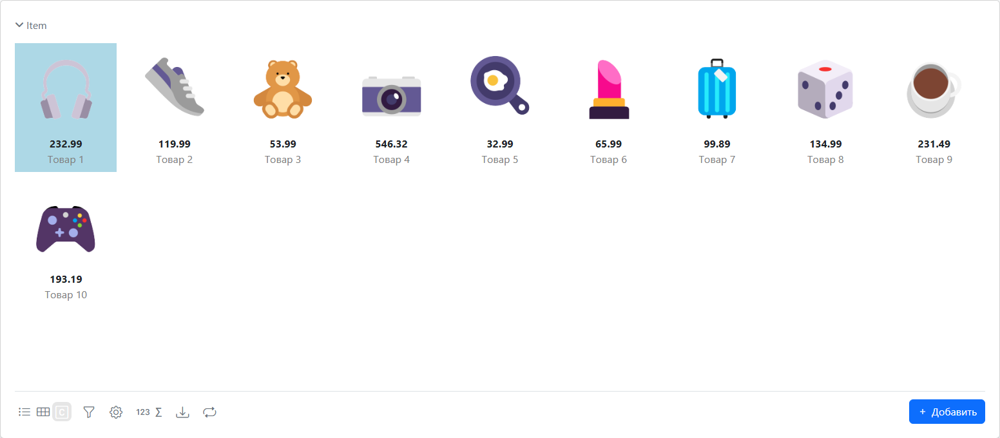

# How-to: Пользовательские компоненты (объекты)

Эта статья описывает классические JavaScript-представления для существующего кода. Для нового представления используйте React-компонент в контейнере `custom` или зарегистрированный как `reactView` для `CUSTOM` ([Представления React](/ru/React_views.md)).

По умолчанию каждый объект на форме с видом представления GRID отображается на форме в виде плоской таблицы со столбцами. Однако, в платформе существует возможность создавать свои собственные компоненты для визуализации списка объектов.

В качестве наглядного примера рассмотрим задачу по отображению в виде "плитки" списка товаров с изображениями.

### Доменная логика[​](#доменная-логика "Прямая ссылка на этот заголовок")

Для начала создадим классы и свойства товаров, а также форму редактирования:

```
CLASS Item 'Item';

name 'Name' = DATA STRING (Item) NONULL;
price 'Price' = DATA NUMERIC[12,2] (Item) NONULL;
picture '' = DATA IMAGEFILE (Item);

FORM item 'Item'
    OBJECTS i = Item PANEL
    PROPERTIES(i) name, price, picture
    
    EDIT Item OBJECT i
;

DESIGN item {
    OBJECTS {
        MOVE PROPERTY(picture(i)) {
            fill = 1;
        }
    }
}
```

Для каждого товара должны быть заданы наименование, цена и изображение.

### Интерфейс[​](#интерфейс "Прямая ссылка на этот заголовок")

Создадим форму со списком товаров. Для этого добавим на форму объект *Товар*, его свойства, а также действия по добавлению, редактированию и удалению:

```
FORM items 'Items'
    OBJECTS i = Item CUSTOM 'itemCards'
    PROPERTIES(i) READONLY picture, price, name
    PROPERTIES(i) NEWSESSION new = NEW, edit = EDIT GRID, DELETE GRID
;

NAVIGATOR {
    NEW items;
}
```

При помощи ключевого слова **CUSTOM** указывается, что для отрисовки списка товаров должен использоваться не стандартный табличный интерфейс, а компоненты, создаваемые функцией *itemCards*. Эту функцию объявим в файле *itemcards.js*, который поместим в папку *resources/web*. Это путь без сборки — обычный файл `.js`, без JSX и упаковки. Где размещается пользовательский JS и о варианте со сборкой см. [Клиентские модули JavaScript](/ru/Client_JavaScript_modules.md#without-the-build). Она будет возвращать объект, состоящий из двух функций: *render* и *update* ([Функция отображения](/ru/Render_functions.md#render-function)).

Напишем функцию *render*:

```
render: (element, controller) => {
    let cards = document.createElement("div")
    cards.classList.add("item-cards");

    element.cards = cards;
    element.appendChild(cards);
},
```

В данном примере мы создаем новый *div* *cards*, запоминаем его и добавляем внутрь *element*.

Напишем функцию *update*:

```
update: (element, controller, list) => {
    while (element.cards.lastElementChild) {
        element.cards.removeChild(element.cards.lastElementChild);
    }

    for (let item of list) {
        let card = document.createElement("div")
        card.classList.add("item-card");

        if (controller.isCurrent(item))
            card.classList.add("item-card-current");

        let cardImage = document.createElement("img")
        cardImage.classList.add("item-card-image");
        cardImage.src = item.picture;
        card.appendChild(cardImage);

        let cardPrice = document.createElement("div")
        cardPrice.classList.add("item-card-price");
        cardPrice.innerHTML = item.price;
        card.appendChild(cardPrice);

        let cardName = document.createElement("div")
        cardName.classList.add("item-card-name");
        cardName.innerHTML = item.name;
        card.appendChild(cardName);

        element.cards.appendChild(card);

        card.onclick = function(event) {
            if (!controller.isCurrent(item)) controller.changeObject(item);
        }
        card.ondblclick = function(event) {
            controller.changeProperty('edit', item);
        }
    }
}
```

Так как функция *update* вызывается каждый раз, когда изменяются данные, то первым делом происходит удаление всех ранее созданных элементов (а именно карточек товаров).

В данном примере используется самая простая схема обновления, но при необходимости ее можно оптимизировать путем обновления DOM только для изменившихся значений при помощи метода [*diff*](/ru/Render_functions.md#diff) контроллера.

После удаления старых элементов для каждого объекта из массива *list* создается свой *div* *card*, в который помещаются нужные элементы отображения каждого свойства ([Строки группы объектов](/ru/Render_functions.md#object-group)).

В самом конце функции добавляются обработчики нажатия кнопки мыши на карточку товара.

По одиночному нажатию у контроллера вызывается метод *changeObject*, который изменяет текущий объект. Второй параметр (*rendered*) не указывается, поэтому сервер в итоге снова вызовет функцию *update* ([Контроллер группы объектов](/ru/Render_functions.md#controller-methods)). Так как значение метода *isCurrent* изменится, то повторное создание карточек товаров изменит текущий выделенный объект в интерфейсе.

По двойному нажатию вызывается метод *changeProperty*, который изменяет текущее значение свойства *edit* для объекта, переданного вторым параметром. Поскольку *edit* является действием, то третий параметр - значение, на которое необходимо изменить текущее значение свойства, не передается, и вместо изменения будет произведен вызов этого действия. В данном случае будет открыта форма редактирования товара.

Чтобы объединить функции *render* и *update* в одну, создается функция *itemCards*, которая возвращает их внутри одного объекта:

```
function itemCards() {
    return {
        render: (element, controller) => {
            ...
        },
        update: (element, controller, list) => {
            ...
        }
    }
}
```

Для завершения настройки дизайна создадим файл *itemcards.css*, которую также поместим в папку *resources/web*:

```
.item-cards {
    display: grid;
    grid-template-columns: repeat(auto-fit, minmax(150px, 1fr));
    grid-auto-rows: 200px;
    grid-gap: 10px;
}

.item-card {
    cursor: pointer;
    display: flex;
    flex-direction: column;
    overflow: hidden;
    align-items: center;
    padding: 8px;
}
.item-card-current {
    background-color: lightblue;
}

.item-card-image {
    flex: 1;
    min-height: 100px;
}

.item-card-price {
    font-weight: bold;
}

.item-card-name {
    color: gray;
}
```

Загрузим `itemcards.js` и `itemcards.css` через [`onWebClientInit`](/ru/Client_JavaScript_modules.md#without-the-build):

```
onWebClientInit() + {
    onWebClientInit('itemcards.js') <- 1;
    onWebClientInit('itemcards.css') <- 2;
}
```

В результате получившаяся форма будет выглядеть следующим образом: 
